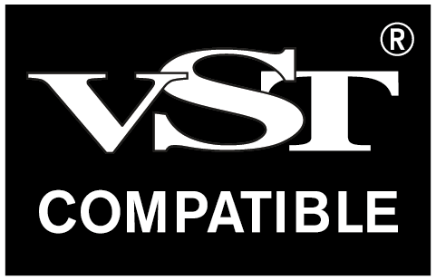
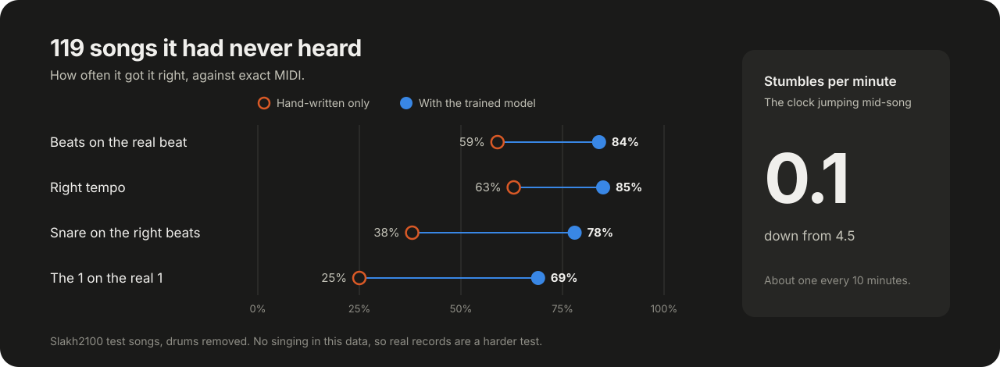

<p align="center">
  
</p>

<p align="center">
  <b>A drummer for when nobody else showed up to practice.</b><br>
  Play guitar or piano. It finds the tempo, works out where the beat is, and plays along.
</p>

<p align="center">
  <a href="https://github.com/Kemerd/drum_along/releases/latest"></a>
  
  <a href="LICENSE"></a>
</p>

Metronomes have no feel. Drum loops don't listen. This one does, and it never asks for gas money.

`drum_along` is a VST® 3 plug-in that hears your audio and plays MIDI drums to match. You don't set a tempo, and you don't need a click. It was built for fun, so go have some.

<a href="https://steinbergmedia.github.io/vst3_dev_portal/">
  <picture>
    <source media="(prefers-color-scheme: dark)" srcset="docs/img/vst-compatible-negative.png">
    
  </picture>
</a>

## What it does

- **Listens.** Plain audio in. Tempo, beat and the "1" all come from the sound alone.
- **Holds the beat.** It bends with you and doesn't chase every wobble, like a real drummer.
- **Follows you.** Dig in and it hits harder. The pattern changes on phrase lines, not at random.
- **Waits.** Stop for a bar and it stops too, then picks you back up. Change tempo after a stop and it finds the new one in about 7 seconds.
- **Plays your drums.** General MIDI out, so any kit you own works: Kontakt, Drum Rack, whatever.
- **Four styles.** Rock, Alt Rock, Pop and Jazz. Switch mid-song without losing the beat.

## Get it

1. Download the zip from [**Releases**](https://github.com/Kemerd/drum_along/releases/latest).
2. Copy the `drum_along.vst3` folder into `C:\Program Files\Common Files\VST3`.
3. Rescan plug-ins in your DAW.

You need 64-bit Windows and a CPU with AVX2, which is nearly anything from the last decade. macOS and Linux builds don't exist yet.

## Plug it in

The bundle has two plug-ins. Pick the one your DAW likes.

| Plug-in | Goes on | Use it in |
|---|---|---|
| **drum_along (FX)** | Your audio track. Sound passes through, drum MIDI comes out. | Reaper, Bitwig, Cubase, Studio One |
| **drum_along (Instrument)** | A MIDI track. Hears you through its sidechain input. | Ableton Live, and any other host |

**In Ableton Live**, which only routes plug-in MIDI from instrument slots:

1. On MIDI track A, insert **drum_along (Instrument)**. Set its sidechain input to your guitar or piano track.
2. On MIDI track B, load your drums. Set *MIDI From* to track A, then pick drum_along in the second chooser.
3. Arm or monitor track B, and play.

## Controls

| Control | What it does |
|---|---|
| **Play** | Off mutes the drums but keeps listening, so it comes back in time. |
| **Style** | Rock, Alt Rock, Pop or Jazz. |
| **Timing Offset** | -50 to +50 ms. Go negative to cancel your drum plug-in's latency. |
| **MIDI Channel** | 1 to 16. Default is 10, the General MIDI drum channel. |

## How it works

<p align="center">
  
</p>

The ears are a small causal neural network with 510k weights and 20 seconds of memory. It runs on your CPU and uses about 2.6% of one core on a fast desktop, the whole plug-in included. No GPU, no cloud.

Everything after the ears is plain, readable logic. The numbers that shape how it plays live in [`weights/drummer.json`](weights/drummer.json), not buried in code. The installed plug-in keeps its copy in `drum_along.vst3/Contents/Resources/weights/`. Edit it, reload the plug-in, and you have a different drummer.

## How good is it?

<p align="center">
  
</p>

| Measure, 119 unseen songs | Hand-written only | With the trained model |
|---|---|---|
| Beats on the real beat | 59% | **84%** |
| Right tempo | 63% | **85%** |
| Snare on the right beats | 38% | **78%** |
| The 1 on the real 1 | 25% | **69%** |
| Stumbles per minute | 4.5 | **0.1** |

Good enough to jam with. Not a session drummer. The honest list:

- **It has only met recordings.** Those scores come from songs with the drums removed. It hasn't been tested with a live player yet, and that's the whole point of it, so tell me how it goes.
- **Singing is new to it.** The training data has none. Real records score lower than the table.
- **The "&" still fools it.** A heavily syncopated riff can put it half a beat off.
- **Intros are hard.** It can come in too early on a long drumless intro, or take its time on a short one.
- **Tempo changes take a moment.** After a clean stop it finds the new tempo in about 7 seconds. Without a stop it takes longer, and keeps the old tempo until it's sure.
- **It only knows 4/4.**
- **It passes Steinberg's validator**, all 94 tests, but it hasn't been played in every DAW.

## Build it yourself

You need Visual Studio 2022 and CMake 3.25 or newer.

```bash
git clone --recursive https://github.com/Kemerd/drum_along
cd drum_along
cmake -S . -B build -G "Visual Studio 17 2022" -A x64
cmake --build build --config Release
```

The plug-in lands in `build/VST3/Release/drum_along.vst3`. To retrain the network or tune the weights, start with [`docs/NOTES.md`](docs/NOTES.md).

## Credits

The network was trained on [**Slakh2100**](https://zenodo.org/records/4599666) by E. Manilow, G. Wichern, P. Seetharaman and J. Le Roux, *Cutting Music Source Separation Some Slakh* (WASPAA 2019), [CC BY 4.0](https://creativecommons.org/licenses/by/4.0/). Drum stems were removed and the rest was remixed for training. Only the trained weights ship here. No dataset audio does.

Built with the [Steinberg VST 3 SDK](https://github.com/steinbergmedia/vst3sdk) and [nlohmann/json](https://github.com/nlohmann/json), both MIT. See [`THIRD_PARTY_NOTICES.md`](THIRD_PARTY_NOTICES.md).

VST is a registered trademark of Steinberg Media Technologies GmbH.

The code and weights here are [MIT licensed](LICENSE), and the weights also carry the Slakh2100 credit above.
